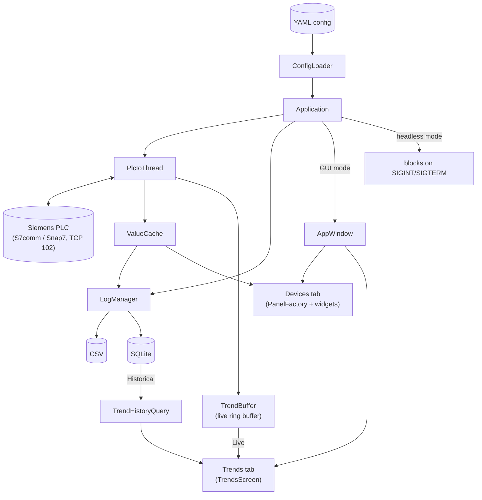

# plc_gui

A Linux desktop application for monitoring and controlling a Siemens PLC over Snap7 (S7comm), with a Dear ImGui interface that is **entirely YAML-driven** — panels, widgets, tag addresses, logging rules, and trend charts all come from config, no recompilation needed. The same core also runs **headless** as a pure data logger.

## Features

- **Live device control panels** — sliders, toggles, buttons, numeric inputs, LED indicators, and text displays, one card per device, built at startup from YAML.
- **Trend charts** — live (in-memory) and historical (SQLite-backed) line/step charts, grouped by device with a per-device select-all toggle.
- **Multi-sink logging** — CSV and SQLite, independently configurable, all tagged by device so multiple instances of the same device type never collide.
- **Device blueprint expansion** — define a device type's fields once (`device_types:`), then instantiate it per physical device (`devices:`) with just an id, DB number, and label — no copy-pasted tag/panel/logging blocks.
- **Headless mode** (`--headless`) — identical polling and logging core, no GUI, suitable for a systemd unit.
- **Config validation** (`--validate-config`) — catches bad YAML, dangling references, duplicate tag ids, overlapping DB byte ranges, and malformed widget params without ever connecting to the PLC.

## Architecture



- `PlcIoThread` owns the single Snap7 connection and does all reads/writes on its own thread, batched per poll group and sized against the PLC's negotiated PDU.
- `ValueCache` and `TrendBuffer` are the only things read by the UI and `LogManager` — neither ever touches the PLC directly, which is what lets headless mode reuse the exact same core.
- `TrendHistoryQuery` opens its own read-only SQLite connection, separate from `LogManager`'s write connection, so a historical chart query never blocks logging.

## Building

Prerequisites (system packages): GLFW3, OpenGL, SQLite3, Snap7, [lmlib-profinet](https://github.com/logicmelt/lmlib-profinet) ≥ 0.6.0 (installed so CMake's `find_package` can locate it), a C++20 compiler, CMake ≥ 3.21. Everything else (Dear ImGui, ImPlot, yaml-cpp, doctest) is fetched automatically via CMake's `FetchContent`.

```bash
cmake -S . -B build
cmake --build build -j
```

This produces three binaries: `build/plc_gui` (the app), `build/fake_plc_server` (a stand-in PLC for local testing), and `build/tests/plc_gui_tests` (the test suite).

## Running

```bash
./build/plc_gui --config config/plc.yaml          # GUI mode
./build/plc_gui --config config/plc.yaml --headless   # no window; Ctrl+C to stop
./build/plc_gui --config config/plc.yaml --validate-config   # check the config and exit, no PLC connection
```

| Flag | Effect |
|---|---|
| `--config <path>` | Config file to load (default `config/plc.yaml`) |
| `--headless` | Run the polling + logging core with no GUI |
| `--validate-config` | Parse and validate the config, then exit (0 = OK, 1 = error) — never connects to the PLC, opens a window, or writes log files |

No real PLC handy? `tools/fake_plc_server.cpp` builds as `fake_plc_server`, an in-process Snap7 server standing in for hardware — point `plc.ip` at `127.0.0.1` and run it alongside `plc_gui` for local testing.

## Configuration

See **[config/README.md](config/README.md)** for a full visual guide to writing a config file, from a minimal `plc.yaml` up through the `device_types:`/`devices:` blueprint pattern for repeated devices.

## Testing

```bash
ctest --test-dir build --output-on-failure
```

Tests that need a live PLC connection run against an in-process Snap7 test server (`tests/support/test_plc_server.*`) rather than real hardware. Since the S7 protocol always uses privileged TCP port 102, those specific tests print a `SKIPPING:` message with the exact fix (`setcap`/`sysctl`) if the environment can't bind it, rather than failing.
