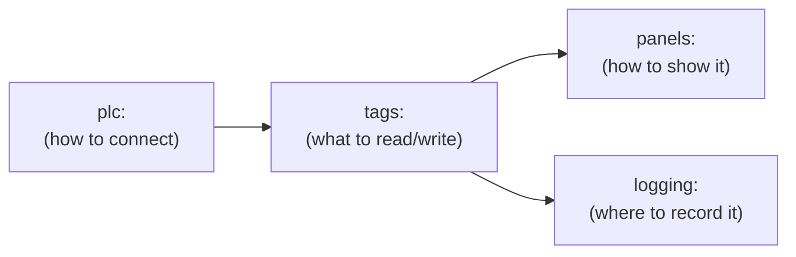
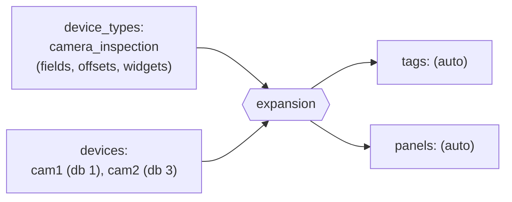

# Writing a config file

Everything the app does — which PLC to connect to, which memory addresses to
read, what the GUI panels look like, where readings get logged — comes from
one YAML file. This guide builds one up from scratch, one concept at a time.
Run `--validate-config` after every step below to check your work without
needing a real PLC connected (see the root [README](../README.md#running)).



## 1. The `plc:` block — how to connect

Every config starts here. `plc:` and `logging:` (step 4, may be empty:
`logging: {}`) are the only top-level blocks the loader requires.

```yaml
plc:
  ip: "192.168.0.10"     # required
  rack: 0                # S7 rack number (0 for S7-1200/1500)
  slot: 1                # S7 slot number (1 for S7-1200/1500)
```

Optional fields, with their defaults:

| Field | Default | Meaning |
|---|---|---|
| `name` | `"PLC"` | Cosmetic label, shown as the main window title |
| `rack` | 0 | S7 rack number |
| `slot` | 1 | S7 slot number |
| `connect_timeout_ms` | 2000 | Parsed but **not currently applied** — Snap7's own default connect timeout is used |
| `reconnect_backoff_ms` | `[500, 1000, 2000, 5000]` | Delays tried in order after a dropped connection (holds at the last value) |

## 2. `tags:` — what to read or write

A tag is one PLC value: a spot in a data block (DB), by byte offset. Each
one needs an `id` (how everything else refers to it), which `db`, a `type`,
and a byte `offset`.

```yaml
tags:
  - id: motor1_speed
    db: 10
    type: real
    offset: 0
    update_interval_ms: 100
```

| `type` | Bytes | Notes |
|---|---|---|
| `bool` | 1 | Needs a `bit: 0`–`7` too — several bools can share one byte |
| `int` | 2 | Signed 16-bit |
| `uint` | 2 | Unsigned 16-bit |
| `usint` | 1 | Unsigned 8-bit |
| `real` | 4 | 32-bit float |
| `time` | 4 | Signed millisecond count, needs even byte alignment in the DB |

Optional per tag: `label` (display name — defaults to `id`), `device`
(groups tags from the same physical device, and is written alongside each
value by the logging sinks so two devices' identically-named tags stay
distinguishable).

**Getting offsets right:** in TIA Portal, the DB's "Optimized block access"
property must be **unchecked** — optimized DBs have no fixed byte layout,
so Snap7 can't read them at all (or worse, silently reads the wrong memory
if some other DB occupies that number). With optimized access off, TIA
Portal's "Offset" column is the ground truth; don't hand-compute it from
struct-packing rules alone.

`--validate-config` catches two things automatically as you add tags:
duplicate `id`s, and two tags in the same `db` whose byte ranges overlap
(bools sharing a byte via different `bit` values are fine — that's normal
packing, not a mistake).

## 3. `panels:` — turning tags into a GUI

A panel is a titled card; each widget inside it renders one tag.

```yaml
panels:
  - title: "Motor Control"
    widgets:
      - { type: slider, tag: motor1_speed, label: "Speed (RPM)", min: "0", max: "3000" }
```

Every widget needs `type` and `tag` (must reference a tag defined above —
`--validate-config` catches dangling references). `label` is optional on
every widget and defaults to the tag's own `label`.

| `type` | Direction | Tag `type` | Extra params | Use for |
|---|---|---|---|---|
| `slider` | writable | `real` only | `min` (default `"0"`), `max` (default `"100"`) | Numeric setpoints |
| `input_number` | writable | any numeric | — | Typed numeric entry |
| `toggle` | writable | `bool` only | — | Booleans held on/off |
| `button` | writable | `bool` only | — | Writes `true` on each click; the PLC program must reset the bit |
| `text_display` | read-only | any | `format` (default `"%.2f"`) | Read-only numeric readout |
| `led_indicator` | read-only | `bool` | — | Read-only boolean status |

⚠️ The "Tag `type`" column is **not checked by `--validate-config`**. A
writable widget bound to the wrong tag type (e.g. a `slider` on an `int`
tag) crashes the app on the first write. `format` must contain exactly one
float conversion (e.g. `"%.1f bar"`), since every value is printed as a
double.

Related widgets can share a titled sub-group inside one panel:

```yaml
panels:
  - title: "Camera 1"
    groups:
      - title: "Inputs"
        widgets: [ ... ]
      - title: "Outputs"
        widgets: [ ... ]
```

## 4. `logging:` — recording tag history

Two parts: `sinks:` (where data goes) and `rules:` (which tags, how often,
to which sinks).

```yaml
logging:
  sinks:
    - id: sqlite_main
      type: sqlite
      path: "logs/plc_log.db"
      table: "plc_readings"
  rules:
    - tags: [motor1_speed, motor1_running]
      interval_ms: 1000
      sinks: [sqlite_main]
```

| Sink `type` | Required fields | Notes |
|---|---|---|
| `csv` | `path` | Appends one row per interval |
| `sqlite` | `path`, `table` | Also backs the historical Trends chart |

A rule needs `interval_ms` and at least one of `tags:` (an explicit list)
or `devices:` (see step 5) plus `sinks:` — both `tags` and `sinks` entries
must reference things defined earlier, or validation fails. You can add
the same tag to multiple rules at different intervals/sinks; sinks are
independent of each other, so having CSV + SQLite both active costs
nothing but disk space.

## 5. Repeated devices — `device_types:` / `devices:`

Steps 1–4 are enough for a one-off config. Once you have several identical
physical devices (e.g. multiple cameras, each its own DB but the same
internal layout), hand-writing tags/widgets/logging per device duplicates
the same block over and over. `device_types:` lets you describe that
layout **once**; `devices:` instantiates it per physical device.



```yaml
device_types:
  camera_inspection:
    update_interval_ms: 200
    fields:
      - { id: in, type: bool, offset: 0, bit: 0, label: "In", writable: true, widget: toggle, group: "Inputs" }
      - { id: finished, type: bool, offset: 6, bit: 0, label: "Finished", widget: led_indicator, group: "Outputs" }

devices:
  - type: camera_inspection
    id: cam1
    db: 1
    label: "Camera 1"
  - type: camera_inspection
    id: cam2
    db: 3
    label: "Camera 2"

logging:
  rules:
    - devices: [cam1, cam2]   # expands to every field of both, automatically
      interval_ms: 1000
      sinks: [sqlite_main]
```

What this expands into, per device instance:

- Each `fields[]` entry becomes a tag with id `<device.id>_<field.id>`
  (e.g. `cam1_finished`), at `db: <device.db>`, offset `field.offset +
  device.offset` (an optional `offset:` on the device lets several
  instances share one DB at different byte ranges instead of one DB each).
- A panel titled after the device's `label`, with one group per distinct
  `group:` value seen across the fields (first-seen order), each widget
  inside built exactly as in step 3.
- A `logging.rules[].devices:` entry expands to every field's tag —
  add a new device's `id` there once and all its fields log automatically.

Field-level rules `--validate-config` enforces:

- `writable: true` requires a writable widget (`toggle`/`button`/
  `input_number`/`slider`); a read-only widget (`led_indicator`/
  `text_display`) requires `writable` to be absent or `false`. Mismatches
  in either direction fail validation.
- Every `devices[].id` must be unique — it's the prefix for every tag the
  device expands to.

Adding a third camera of the same type is then just four lines under
`devices:` (`type`, `id`, `db`, `label`) plus its `id` in the logging
rule's `devices:` list — no repeated tag/panel/widget blocks.

## Full minimal example

See [`plc.yaml`](plc.yaml) for steps 1–4 combined into one small runnable
config, and [`demo.yaml`](demo.yaml) for the `device_types:`/`devices:`
pattern from step 5 alongside every other feature.
